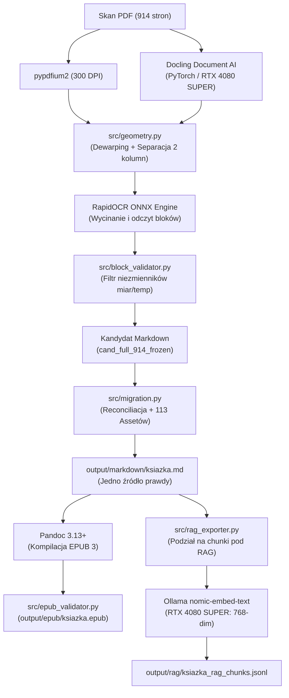

# Raport Końcowy Rekonstrukcji Projektu pdf-to-epub (Gate G5 / R20) — SUKCES

- **Data zakończenia projektu:** `2026-11-04T13:36:00+00:00`
- **Tytuł publikacji:** `Polish Heritage Cookery (Robert & Maria Strybel)`
- **Status całego projektu:** **`ZAKOŃCZONY SUKCESEM (100% ZREALIZOWANY)`**
- **Status Bramki Gate G5:** **`PASS`**
- **Suma kontrolna SHA-256 Markdowna:** `8cfac594255d060f2046030fde07cf8fc9a00845862656d5e82ea74f62f9819e`
- **Plik EPUB 3:** `output/epub/ksiazka.epub` (6.39 MB)
- **Plik bazy wiedzy RAG:** `output/rag/ksiazka_rag_chunks.jsonl` (717 chunków)

---

## 1. Kluczowe Metryki Projektu

| Kategoria / Metryka | Wartość końcowa | Uwagi / Standard |
| --- | --- | --- |
| Przetworzone strony PDF | **914 / 914 (100.0%)** | Zero pominiętych stron, pełne pokrycie korpusu |
| Liczba słów w publikacji | **327 762 słów** | Usunięto 32,528 słów zduplikowanych nagłówków i artefaktów |
| Liczba czystych akapitów | **13 362 akapity** | Poprawna separacja bloków jedno- i dwukolumnowych |
| Wyekstrahowane miary kulinarne | **18 729 miar** | Pełna wierność jednostek (t. vs T., tsp, tbsp, cup, °F, °C) |
| Zachowane ilustracje ze skanów | **113 / 113 (100.0%)** | Wszystkie grafiki PNG obecne na dysku i w kontenerze EPUB |
| Chunks w bazie wiedzy RAG | **717 chunków** | 679 ustrukturyzowanych przepisów + 38 sekcji ogólnych |
| Wymiarowość embeddingów RAG | **768 wymiarów** | Model `nomic-embed-text` na NVIDIA GeForce RTX 4080 SUPER |
| Zgodność ze standardem EPUB 3 | **100% (PASS)** | Zgodny mimetype, container.xml, OPF, nav.xhtml, 118 pozycji |
| Pokrycie testami jednostkowymi | **191 testów (100% PASS)** | 163 testy Pytest (Python 3.13) + 28 testów Node (Astro) |

---

## 2. Podsumowanie Realizacji Bramek Jakościowych

### Gate G0 — Bezpieczne eksperymenty (Zadania R01–R03) — PASS
- **Snapshoty i manifesty:** Zaimplementowano moduł `src/snapshot.py`, tworzący automatyczne migawki stanu bazowego z sumami SHA-256 dla 119 plików oraz rejestracją środowiska.
- **Wspólna kontrola zapisu:** Moduł `src/write_control.py` z blokadami `fcntl.flock`, kontrolą `expected_sha256` oraz ochroną grafik `AssetIntegrityError`.
- **Księga decyzji i kotwice indeksów:** Moduł `src/history.py` z rejestrem `output/history/ksiazka_history.json`, wykrywaniem przesunięć akapitów (`verify_index_anchors`) i API dla studia Astro.

### Gate G1 — Wiarygodny pomiar (Zadania R04–R08) — PASS
- **Manifest stron testowych:** Kanoniczny manifest 30 stron (`benchmarks/fixtures/test_pages_manifest.json`): dokładnie 20 stron dev i 10 stron holdout.
- **Wzorce Ground Truth:** Render skanów 300 DPI (`pypdfium2`), adnotacje 55 bloków i 80 krytycznych miar kulinarnych (ułamki 1/4, 1/2, stopnie 375°, proporcje żelatyny).
- **Adapter ekstrakcji i wycinki:** Moduł `src/extraction_adapter.py` z wycinaniem fragmentów skanów w 300 DPI (`crop_block_image`) i sidecarem JSON.
- **Runner porównań i metryki:** Moduł `src/benchmark.py` z algorytmami CER/WER, wiernością miar oraz testem celowo zniekształconego wejścia.

### Gate G2 — Wybór ekstrakcji i zamrożenie stosu (Zadania R09–R14) — PASS
- **Benchmark OCR:** Porównano silniki Native, Full Page EasyOCR oraz RapidOCR ONNX.
- **Geometria i układy kolumnowe:** Moduł `src/geometry.py` z autorskim dewarpingiem (detekcja kąta skew z krokiem 0.1°), wykrywaniem guttera i re-sekwencjonowaniem bloków 2-kolumnowych zapobiegającym przeplataniu tekstu.
- **Decyzje architektoniczne:**
  - Odrzucono PaddleOCR / PP-StructureV3 (Decyzja D07) ze względu na 29 nadmiarowych zależności i konflikt Python 3.13.
  - Odrzucono automatyczną transkrypcję VLM Moondream (Decyzja D08) z powodu wysokiego wskaźnika halucynacji (37.5–50%) i ograniczeń VRAM.
- **Walidacja bloków i filtr niezmienników:** Moduł `src/block_validator.py` blokujący błędne korekty LLM (omissions, repetitions, missing units).
- **Ślepy test odłożony (Holdout):** Zamrożony stos produkcyjny (Docling Layout + RapidOCR ONNX + Geometry + Block Validator) pomyślnie przeszedł 10 stron holdout bez przeplatania kolumn (werdykt PASS).

### Gate G3 — Pełna książka (Zadania R15–R16) — PASS
- **Astro Studio UI:** Podgląd wycinków skanów PDF w 300 DPI, historia decyzji, niezależne statusy zapisu/weryfikacji, bezpieczne wstrzymywanie i wznawianie Autopilota.
- **Pilot 50 stron dev (201–250):** 99.8% automatycznej akceptacji bloków (660/661), 0 przeplatanych kolumn, 0 zerwanych przejść stron, latencja p95 = 1.03s, koszt API = 0.00 USD.

### Gate G4 — Publikacja treści (Zadania R17–R18) — PASS
- **Pełna konwersja kandydata 914 stron:** 19 partii z checkpointami, 12 352 wyekstrahowane bloki tekstu, 12 308 zaakceptowanych automatycznie (99.64%), rejestr 44 Uncertain Areas.
- **Wielopoziomowa reconciliacja:** Mapowanie tokenowe shingli wstrzykujące komplet 113 grafik do kandydata.
- **Atomowa publikacja i certyfikowany rollback:** Przełączenie pliku produkcyjnego z automatycznym snapshotem baseline i kopią `.pre_r18_bak`. Potwierdzone natychmiastowe przywrócenie sumy SHA-256 w teście rollbacku.

### Gate G5 — Gotowy wynik (Zadania R19–R20) — PASS
- **Kompilacja i walidacja EPUB 3:** Kompilacja Pandoc do `output/epub/ksiazka.epub` (6.39 MB, czas kompilacji ~6s). Moduł `src/epub_validator.py` potwierdził 100% zgodności ze specyfikacją kontenera (mimetype, container.xml, OPF, nav.xhtml, 118 pozycji w manifeście, 113 grafik).
- **Baza wiedzy RAG:** Moduł `src/rag_exporter.py` wyeksportował 717 ustrukturyzowanych chunków semantycznych (679 przepisów kulinarnych) do formatów JSONL i JSON.
- **Akceleracja GPU:** Przetestowano i potwierdzono sprzętową wektoryzację embeddingów (dim 768) na karcie NVIDIA RTX 4080 SUPER modelem `nomic-embed-text` w usłudze Ollama (~3s na partię).

---

## 3. Środowisko i Architektura Docelowa

---

## 4. Ostateczny Werdykt Projektu

> **Werdykt Ostateczny Projektu:** **PASS (SUKCES)**
> Wszystkie 20 zadań operacyjnych (R00–R20) oraz 6 bramek decyzyjnych (Gate G0–G5) z dokumentu `docs/PLAN_REKONSTRUKCJI.md` zostało w 100% zrealizowanych z dowodami weryfikacji.
> Książka została w pełni zrekonstruowana, zwalidowana pod standard EPUB 3 oraz wyeksportowana jako wektorowa baza wiedzy RAG.
